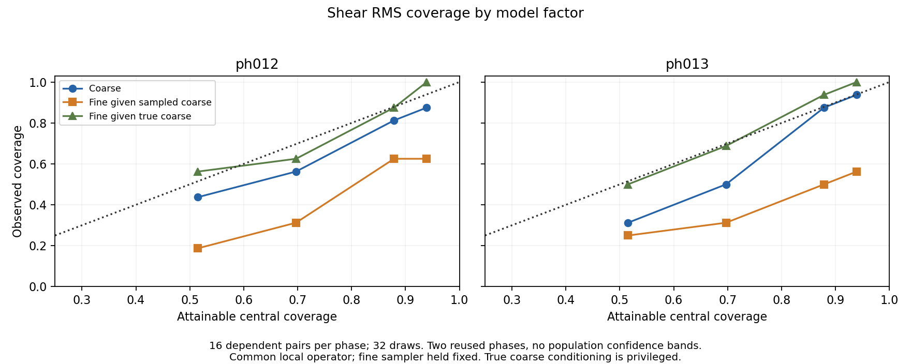
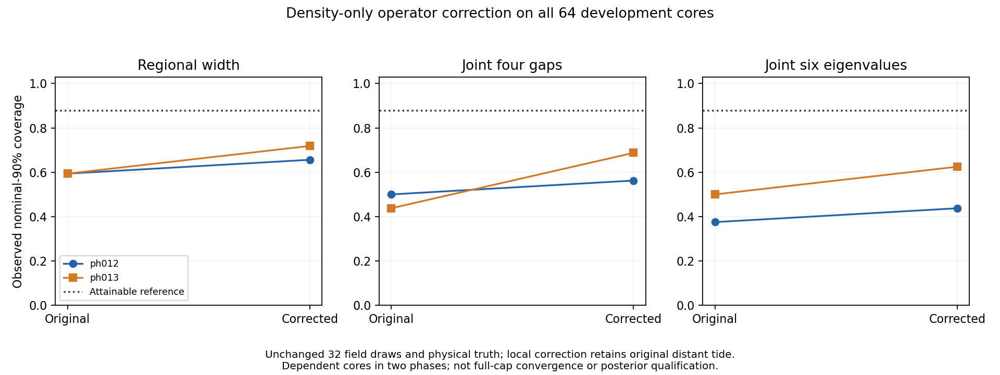

# Stage A calibration investigation execution

## Authority and scope

On 6 October the user authorized Stage A of the
[working plan](e2e_cfm_calibration_investigation_plan_20261006.md), all required
compute, and inspection/cancellation of queued jobs no longer worth retaining.
This executes A0/A1 and the bounded A2 operator replay. It does not authorize
model fitting, Stage B property analysis, a new production model, publication
or opening ph001/ph018/ph019. Development scientific reads remain ph012/ph013.

## Queue decision

The audit found 141 pending generation tasks in array59238002 and three dependent
jobs:59238010 scoring,59238614 website preparation and59241627 field summary.
All development012/013 draws needed for Stage A were already complete. Pending
generation was distributed as ph014:2,ph015:11,ph016:16,ph017:16,ph018:16,
ph019:16,legacy004/005/006:16 each,Loa:16. No tasks were running at audit time.

Cancel this pending expansion of the old unqualified candidate and its downstream
chain. The scorer would open fresh confirmation and the website chain is not
needed for diagnosis. Cancellation is limited to the audited pending jobs;
completed outputs, immutable sources and manifests are preserved. The chain can
be resubmitted later if justified. `sacct` confirmed144 cancellations and50
completed tasks in the queried array/dependency inventory. The separate earlier
pilot is not included in that completed-array count.

Exact pre-cancellation metadata is in
[the queue audit](../configs/e2e_stage_a_queue_audit_20261006.json).
No scientific confirmation payload was read for this metadata audit.

## Frozen first stage measurements

Use32draws and all32registered development pairs. Primary diagnostic entries are
canvas coarse shear RMS and joint regional traceless-tensor projections;
true-coarse-conditioned fine shear RMS and its joint projections; full-cap
physical-target four-gap and six-eigenvalue regional joint tests. Retain the
other registered scalar, mass, operator-matched and cross-scale diagnostics.

Five orthonormal shear coordinates are `(Txx-Tyy)/sqrt(2)`,
`(Txx+Tyy-2Tzz)/sqrt(6)`, `sqrt(2)Txy`, `sqrt(2)Txz`, `sqrt(2)Tyz`.
Use means within each original core; paired vectors have ten components.
Coarse–fine vectors concatenate those coordinates. Summaries do not establish
orientation-field or full functional-posterior calibration.

Existing per-draw tensor means, shear amplitudes and eigenvalues are reused;
the missing matching truth tensor means are independently computed with the
CPU spectral operator. Hash inputs and draw payloads. Reproduce stored truth
eigenvalue summaries before scoring. Bind actual imported metric-source files,
including the immutable campaign source, not just the current Git revision.

Coverage references are metric-specific. Keep the plan's0.05 descriptive screen,
0.10split deficit screen and insufficient-independent-evidence qualification.
Report phase, shell, cap and support strata; actual count/support values are
recorded per case. No evaluation-derived count threshold is used to select a
favourable subpopulation. No population significance claim follows from these
two phases.

## Engineering controls

Six initial tests passed for phase guards, orthonormal shear, direct all-pairs
fair CRPS, deterministic/empty targets, eigengap covariance and group denominators.
An additional test checks cell-fraction normalization and finite-M Brier correction.

The initial512case stochastic Gaussian joint-rank control failed its engineering
absolute0.06band at50%: observed0.552734 versus attainable0.484848. The other
levels were0.720703/0.90625/0.947266 versus0.666667/0.878788/0.939394.
The failed pilot is preserved. No scientific cases were scored in that attempt.

The actually imported scorer matched the established permutation-equivariant
leave-one-out definition. Replace stochastic pass/fail for this algebraic null
with an exact check: cycle all33members of each fixed Gaussian/heavy-tail vector
ensemble through the truth position, for dimensions4,4,6,10. All attainable
coverage levels agree exactly. Retain the original512case Monte Carlo result
in the control receipt rather than changing seeds or hiding it. Biased,
underdispersed, shuffled-dependence, discrete-rank, empty and deterministic
controls must also pass. This strengthens scorer validation; scientific
acceptance criteria are unchanged.

The second A1 pilot used one fixed geometry case per phase, replayed truth
eigenvalues to1e-10 and completed in6.49seconds overall, with0.91/0.85seconds per
scientific case. This supports the full panel within the approved CPU envelope.

## Allocations and artifacts

CPU59397965 on nid200045:2hour interactive allocation. GPU59398460 on nid200432:
one80GB A100,2hour shared-interactive allocation. These are the only two new
allocations. Large-array processing runs through compute-node steps in cosmic_env.

Scratch root:
`/pscratch/sd/d/dkololgi/abacus/e2e_field_v3/calibration_investigation_20261006_v1`.
`a1_pilot1` is the preserved failed control attempt; `a1_pilot1_attempt2` is the
passing pilot. `a1` is the full factor panel. `a2_pilot` benchmarks two original
NGCdraws per phase across every registered NGCcore; its moments are engineering
outputs, not calibration results. A2expansion depends on replay, mass/trace,
truth parity and measured time/memory gates.

A2 reuses one full-cap tensor solve per draw across all eight pairs of that cap,
then applies each local conservative correction. Physical truth is unchanged.
The original and corrected density-field pushforwards share draw addresses.
Record cell eigenvalue scores and volume-weighted class fractions/Brier, but
defer discrete joint fraction qualification and galaxy-position reliability to
Stage B. No all-core local-replay result implies full-cap operator convergence.

## Results and decision

The bounded Stage A diagnostic panel is complete: 32 pairs, 64 cores, 32 saved
draws, ph012/ph013 only. Numerical success is not posterior qualification.
No retraining, fresh confirmation, galaxy reliability analysis or production
change was performed. Cached density interval widths at 50/68/95% were not
available and remain unreported; their coverage and fair CRPS are available.

### A1 Factor and composition scores

All entries below are observed nominal-90% coverage. The continuous scalar and
these joint-rank tests both have reference 29/33 = 87.879% at this level, but
their references differ at other levels. Scalar shear RMS is one window-level
statistic per pair (16 per phase); regional trace/width uses two core targets per
pair; joint tests use one vector per pair. None of these targets are iid cases.

| Statistic | ph012 | ph013 |
| --- | ---: | ---: |
| Composed voxel density, cached | 87.24% | 88.61% |
| Coarse regional trace | 78.125% | 93.75% |
| Coarse shear RMS | 81.25% | 87.50% |
| Coarse joint traceless-tensor projections | 81.25% | 81.25% |
| Fine shear RMS given sampled coarse, fixed single-window sampler | 62.50% | 50.00% |
| Fine shear RMS given true coarse, same sampler | 87.50% | 93.75% |
| Fine joint traceless-tensor projections given true coarse | 93.75% | 93.75% |
| Oracle-conditioned composed joint four gaps, matched target | 81.25% | 75.00% |
| Full-cap physical regional width | 59.375% | 59.375% |
| Full-cap physical joint four gaps | 50.00% | 43.75% |
| Full-cap physical joint six eigenvalues | 37.50% | 50.00% |

Voxel density passes the descriptive 0.05 coverage-curve screen in both phases;
this does not establish a calibrated spatial posterior. Coarse shear RMS is
less well covered at middle credibility: at nominal 50/68%, ph012 gives
43.75/56.25% and ph013 gives 31.25/50%, against 51.515/69.697% attainable.
Coarse trace also changes from undercoverage to overcoverage between phases.
Thus the coarse factor is not cleared by an almost-correct average amplitude
or its near-reference pooled 90% coverage.

The fine conditional improves substantially with true coarse conditioning,
holding the fine sampler fixed. Its remaining joint-gap failures mean that
the oracle arm is not uniformly calibrated. This is privileged conditioning,
not a deployable candidate or proof that all error belongs to the coarse model.
The full canvas fine-RMS coverage is still poorer, 56.25/37.50%; that additional
comparison changes sampling/context and must not be merged with the matched
conditioning intervention.



### Failure map, not just pooled averages

Shells 0–3 are the registered redshift bands 0.15–0.25, 0.25–0.35,
0.35–0.45 and 0.45–0.55. Each shell has four pairs per phase; each cap/support
stratum has eight. The table gives ph012/ph013 percentages at nominal 90%.
These small dependent strata are descriptive screens, not precise population
coverage estimates. Every registered split remains in the JSON scorecard.

| Split | Coarse shear RMS | Fine RMS given sampled coarse | Fine RMS given true coarse |
| --- | ---: | ---: | ---: |
| Shell 0 | 25 / 75 | 25 / 50 | 75 / 75 |
| Shell 1 | 100 / 75 | 50 / 25 | 75 / 100 |
| Shell 2 | 100 / 100 | 75 / 50 | 100 / 100 |
| Shell 3 | 100 / 100 | 100 / 75 | 100 / 100 |
| NGC | 75 / 75 | 50 / 37.5 | 100 / 87.5 |
| SGC | 87.5 / 100 | 75 / 62.5 | 75 / 100 |
| Interior | 75 / 75 | 50 / 37.5 | 75 / 87.5 |
| Boundary | 87.5 / 100 | 75 / 62.5 | 100 / 100 |

The failure is not simply a high-redshift or boundary problem: the sampled-
coarse fine-RMS deficits are strong in low/middle-redshift and interior cases.
Actual observation counts/support fractions are retained per case, without
fitting new count bins on evaluation data. Cross-scale vector scores and
noise-corrected error-covariance diagnostics are retained as diagnostics;
near-reference coverage of one joint statistic does not override the failures
of another functional such as shear RMS.

### A2 Density-only operator candidate

The all-core, per-draw positive central-linear correction improves mean width
and proper scores, but leaves substantial physical-target undercoverage.
It recovers roughly 32% of the posterior mean-width deficit, not the roughly
65% recovery previously found when reconstructing the true coarse density.
The latter is a different experiment and must not be used as a posterior gain.

| Physical-target statistic | ph012 original → corrected | ph013 original → corrected |
| --- | ---: | ---: |
| Regional mean width deficit | 7.647% → 5.222% | 7.681% → 5.235% |
| Width posterior SD | 0.02812 → 0.02873 | 0.02734 → 0.02790 |
| Width fair CRPS, lower is better | 0.03412 → 0.02857 | 0.03119 → 0.02450 |
| Width coverage | 59.375% → 65.625% | 59.375% → 71.875% |
| Joint four-gap coverage | 50.00% → 56.25% | 43.75% → 68.75% |
| Joint six-eigenvalue coverage | 37.50% → 43.75% | 50.00% → 62.50% |
| Joint six-eigenvalue fair energy | 0.04631 → 0.04148 | 0.04061 → 0.03508 |



Cell-level eigenvalue fair CRPS improves for all three eigenvalues in both
phases. Cell multiclass fair Brier also improves at both frozen thresholds:
at threshold 0.2 it falls from 0.36844 to 0.36613 in ph012 and from 0.35440 to
0.35177 in ph013. These gains are small. Classes are void, wall, filament,
cluster for 0, 1, 2, 3 eigenvalues above the threshold. At 0.2, volume wall
fraction biases improve from −1.733/−1.550 to −0.742/−0.555 percentage points;
filament biases improve from −0.715/−1.075 to −0.524/−0.883 points. Improvement
is not universal: at threshold zero the ph012 filament-fraction bias grows
from +0.309 to +0.771 points. Fraction-interval continuous references are only
descriptive because fractions can tie. Discrete joint-fraction qualification
and galaxy-position probability reliability remain Stage B work.

Decision: retain the operator correction as a useful controlled candidate, not
a sufficient repair or a production replacement. Do not launch augmentation,
longer training or fresh confirmation from these results. The next decision
point is Stage B1/B2 on matched galaxy positions and regional fractions, with
the original and corrected operators compared under the same selection. That
requires a separate implementation authorization. Two reused phases remain
insufficient for population qualification, regardless of numerical screens.

## Verification, receipts and resources

All seven focused unit tests pass. A1 completes in 34.82 seconds with 1.411 GiB
peak host RSS. The full A2 replay completes in 369.06 seconds (6.15 minutes),
with 19.787 GiB peak host RSS and 35.475 GiB peak allocated GPU memory.
Full-cap solves plus eight local pair corrections take about 2.1–2.7 seconds
per draw, after cached-kernel initialization; the total includes scoring/I/O.

Numerical checks pass on all 64 cores: original cell eigenvalue replay maximum
error 1.187e-7 (float32 stored outputs), original regional replay 4.736e-10,
correction trace error 1.029e-14, CPU/GPU reconstructed-truth parity 1.666e-16.
The correction uses only each draw's density; the prior conservative-reconstruction
tests verify positive density and parent-cell mass. The review independently
checks 544 A1 scalar/joint arithmetic conditions, reproduces all 96 tested A1
joint ranks exactly using centered matrix products and Cholesky, and checks all
32 A2 cases for baseline replay, fraction normalization, both physical joint
six-eigenvalue ranks and width CRPS (maximum discrepancy 4.164e-17).

Artifacts relative to the scratch root above:

| Artifact | SHA256 |
| --- | --- |
| `a1/COMPLETE.json` | `07d367965e31a9e2d21ec6aa6f16cbae848c612c0c6ffa495583ad15f0ac3749` |
| `a2/COMPLETE.json` | `cab562ac1b61fab9b87814a9ef7def28fc7a8516068cdaae16b024b444cfce09` |
| `REVIEW.json` | `190e0197877611f96567a799a37c6da5abb445032fcfd13cb5340d37b4dcc709` |

`a1/BINDING.json`, `a1/CONTROLS.json`, `a2/BINDING.json` and per-case JSON/NPZ
files preserve inputs, actual imported scorer source hashes, draw identity,
stratum denominators and the failed/passing synthetic controls. The review
also binds cached full-cap density/mass scores after verifying their freeze and
source receipts; it does not silently regenerate unavailable interval widths.

Entrypoints, using cosmic_env on allocated compute:

```text
python workflows/sbi/e2e_stage_a_calibration.py --limit 1 --attempt 2
python workflows/sbi/e2e_stage_a_calibration.py
python workflows/sbi/e2e_stage_a_reconstruction.py --pilot
python workflows/sbi/e2e_stage_a_reconstruction.py
python workflows/sbi/e2e_stage_a_review.py --a2 --figures docs/figures/e2e_stage_a_20261006
python -m unittest discover -s tests/phase4 -p test_e2e_stage_a_calibration.py
```

Execution directories are create-once; these commands document the runs, not
permission to overwrite them. The review report/figures are regenerable derived
outputs. Both allocations completed and were released: CPU59397965 after
18m27s and GPU59398460 after 14m29s. The user's queue was empty at final check.
No completed scientific output was deleted.

Repository graph refresh was blocked by the safety reviewer as an insufficiently
scoped mutation. A separate read-only check also found no `graphify` executable
on PATH. No bypass or global-graph update was attempted; direct source inspection
and the checks above provide the task validation.
