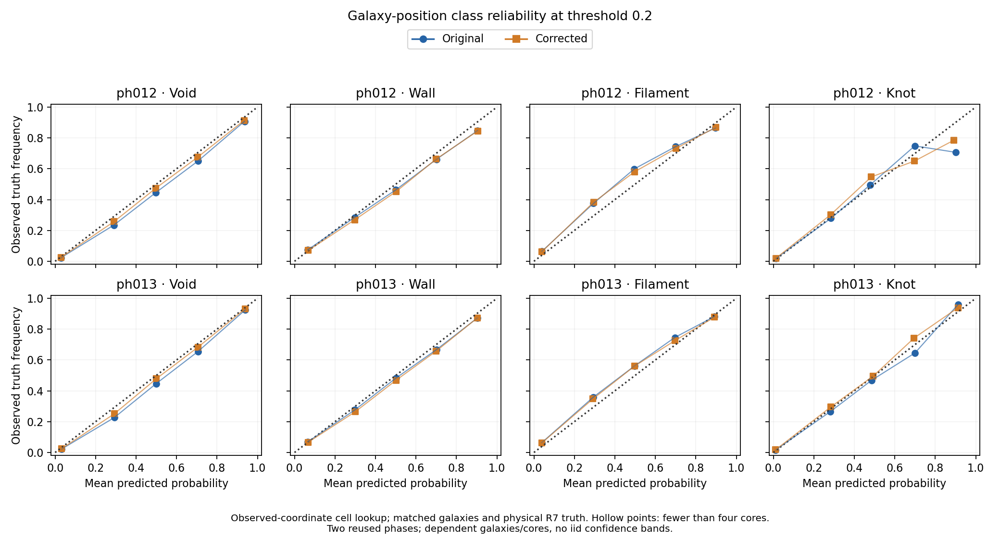
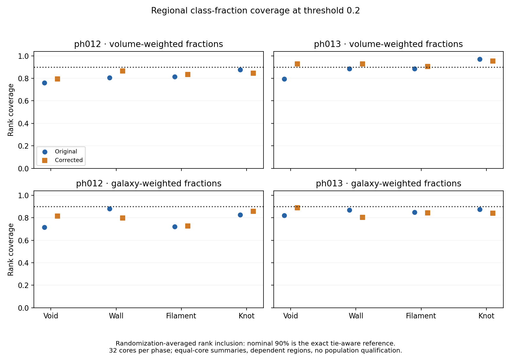

# Stage B galaxy reliability and regional class fractions

## What Stage A established

The posterior can reproduce voxel-density coverage while failing uncertainty
tests for spatial structure. In the two development phases, nominal-90% density
coverage was 87.24/88.61% against the 87.879% finite-draw reference, but original
joint six-eigenvalue coverage was only 37.5/50%. Good marginals and average
amplitudes are therefore inadequate acceptance tests for a coherent field.

The coarse factor is not cleared: its middle-credibility shear coverage and
regional trace fail descriptive screens. Holding the fine sampler fixed,
true-coarse conditioning raises fine-shear coverage from 62.5/50% to
87.5/93.75%, but some oracle-conditioned joint summaries still fail. This
implicates conditioning/composition without assigning all error to one factor.

The density-only operator correction is useful but insufficient. Mean regional
width deficit falls from about 7.7% to 5.2%; corrected joint six-eigenvalue
coverage is 43.75/62.5%, still poor. These tests justify assessing consequences
for class probabilities and regional class fractions, not automatic augmentation,
longer training, a new physical target or promotion. Two reused phases cannot
certify population calibration. Full results are in the
[Stage A record](e2e_stage_a_execution_20261006.md).

## Authorization and frozen scope

The user requested Stage B and explicitly approved one CPU allocation up to
two hours and, if needed, one shared GPU up to two hours. Execution uses one
hour per allocation initially. No new posterior sampling or training is allowed.
B1/B2 use all 32 development pairs and 64 cores in ph012/ph013, with the same
32 original field draws. B3 is a property-availability audit only; a property
estimator or synthetic law requires a separate freeze before scoring contrasts.
Ph001 remains excluded; ph018/ph019 and other evaluation phases remain unopened.

The [Stage B configuration](../configs/e2e_stage_b_20261006.json) fixes selection,
positions, bin edges, proper scores, tie rules, phase roles and both operators
before new class scores. A narrow training-data read supplies the requested
non-informative comparator: the `_00` pair in each cap/shell/support stratum of
each of the 13 already-trained phases. These 208 pairs are selected by geometry,
not observed results. They fit only the comparator's class frequencies, not the
CFM or any calibration correction. No development label enters that baseline.

## Galaxy and truth alignment

Use the verified successful BGS_BRIGHT catalogue and its TARGETID–sky–RSD join.
Select observed redshift 0.15 <= Z < 0.55, then galaxies inside each registered
half-open core with positive random-support fraction in the containing cell.
Use the pinned DESI distance table and Mpc/h convention. Keep unique IDs,
positions, cell addresses, support exclusions and fixed per-core denominators.
Shell labels remain the registered core-centroid shells, not newly fitted bins.

Both predictions and physical full-box R7 truth use the **same containing-cell
lookup**. The 6.766 Mpc/h cell tensor is averaged before its eigenvalues are
computed; no eigenvalue interpolation, extrapolation or second smoothing occurs.
This tests the field class at observed-coordinate galaxy cells. It does not
claim to recover true-host/real-space galaxy environments, native pointwise
tidal values, P12-A targets or a DESI VAC product.

All 32 pairs align without duplicated galaxy IDs across cores. Selected counts
are 79,067 in ph012 and 107,485 in ph013. Five and seventeen galaxies respectively
are excluded by the zero-support rule. Sparse high-redshift cores remain present:
the smallest development core has one selected galaxy. All 64 cores are nonempty.
The training-only comparator contains 1,061,074 galaxies. At primary threshold
0.2 its probabilities for void/wall/filament/knot are
0.235391/0.426268/0.285453/0.052888. These are galaxy-weighted prevalences under
the declared training-panel selection, not equal-volume cosmic class fractions.

## Class reliability and regional uncertainty

B1 reports galaxy-weighted raw and finite-ensemble-corrected multiclass/classwise
Brier scores, fixed-bin reliability and hard-label confusion/purity/completeness.
Bins are [0,0.2), [0.2,0.4), [0.4,0.6), [0.6,0.8), [0.8,1]. Empty bins remain
visible; fewer than four contributing cores is sparse in each phase. The 0.05
reliability-residual screen is descriptive, not a claim of precise equivalence.
Hard labels use maximum posterior class probability with deterministic tie order.

B2 computes each draw's four class fractions with two separate denominators:
all 4096 original cells per core, and the fixed selected galaxies in that core.
Do not replace their joint distribution with fractions of posterior-mean labels.
Report all four marginal fractions and paired-core differences. Joint tests use
the first three simplex coordinates per core, six for a pair, and three for
the right-minus-left contrast. The original and corrected operators share IDs,
draws, supports and unchanged physical truth. Threshold 0.2 is primary; zero
is the frozen sensitivity check.

Fractions can tie. For a truth rank with `L` strictly smaller values and `E`
equal values including truth, use `(L + U E)/(M+1)`, with U uniform on [0,1].
The primary diagnostic analytically averages inclusion over U: a central rank
band for scalar fractions and an upper rank cutoff for joint outlyingness.
This has exact **nominal** exchangeable coverage even with finite M and ties.
It differs from Stage A's inclusive continuous intervals and 29/33 reference;
those values must not be compared as though the scoring conventions were equal.
Inclusive fraction intervals and widths remain secondary descriptive outputs.
Degenerate joint cases remain flagged and proper scores retain information value.

Joint outlyingness retains 20% diagonal shrinkage and the fixed relative ridge.
Identical vectors are scored once from sorted unique values and multiplicities,
preventing input-order roundoff from breaking discrete duplicate ties. Cycling
every member of discrete, continuous and degenerate 33-member synthetic ensembles
through the truth position gives exact nominal scalar/joint rank inclusion.
Eight focused tests cover endpoints, Brier arithmetic, empty support, tied ranks,
CRPS, geometry/phase guards and sensitivity to bias/underdispersion. The first
endpoint test caught a floating `linspace` edge at 0.6; explicit decimal edges
fixed it before any reliability score was produced.

## B1/B2 results and decision

At threshold 0.2, galaxy-weighted multiclass Brier scores are:

| Score | ph012 | ph013 |
| --- | ---: | ---: |
| Training-prevalence baseline | 0.68308 | 0.68390 |
| Original raw Brier | 0.38533 | 0.36959 |
| Corrected raw Brier | 0.38236 | 0.36729 |
| Original finite-ensemble-corrected Brier | 0.37407 | 0.35833 |
| Corrected finite-ensemble-corrected Brier | 0.37115 | 0.35608 |

The fields are informative: fair Brier is about 45–48% below the baseline.
The operator correction adds only 0.78/0.63% relative improvement. It reduces
the number of fixed class/probability bins exceeding the 0.05 residual screen
from 7/20 to 5/20 and 6/20 to 2/20. Nevertheless, maximum residuals remain
0.1070/0.0632; reliability is not repaired. None of these pooled phase bins is
sparse under the four-core rule. The baseline passes its four occupied-bin
residual screens while having much worse Brier: reliability alone does not
establish information value. Knot-class Brier slightly worsens after correction.

Pooled galaxy scores are dominated by lower redshifts. Registered shell counts
and corrected fair Brier illustrate why they cannot qualify the full range:

| Core-centroid shell | ph012 galaxies | ph013 galaxies | ph012 fair Brier | ph013 fair Brier |
| --- | ---: | ---: | ---: | ---: |
| 0.15–0.25 | 58,029 | 76,259 | 0.36146 | 0.34890 |
| 0.25–0.35 | 17,457 | 24,181 | 0.38646 | 0.36135 |
| 0.35–0.45 | 3,134 | 6,718 | 0.43666 | 0.41149 |
| 0.45–0.55 | 447 | 327 | 0.57208 | 0.50057 |

These are centroid strata, not a claim that every galaxy lies in its core's
redshift bin. The ph013 highest-shell score slightly worsens after correction
(0.50051 to 0.50057); its very small sample limits interpretation.

Paired-core joint fraction diagnostics expose a distinction between volume and
galaxy weighting. Coverage below is the nominal-90% tie-aware rank diagnostic;
energy is a proper score for the paired six-coordinate fraction vector.

| Diagnostic | Original ph012/ph013 | Corrected ph012/ph013 |
| --- | --- | --- |
| Galaxy-weighted joint coverage | 71.25 / 75.00% | 71.25 / 68.75% |
| Volume-weighted joint coverage | 77.50 / 91.875% | 79.375 / 93.75% |
| Galaxy-weighted joint energy | 0.11871 / 0.10514 | 0.11665 / 0.10385 |
| Volume-weighted joint energy | 0.07081 / 0.05908 | 0.06542 / 0.05282 |

No paired-joint full coverage curve passes G2, including the ph013 volume
curve whose 90% point looks acceptable. Galaxy-weighted wall-fraction marginal
coverage worsens from 88.00/86.80% to 79.68/80.24%; wall and knot marginal CRPS
also worsen in both phases. The modest joint-energy improvement does not imply
that every class or downstream contrast improves. The galaxy right-minus-left
joint contrast passes its full curve screen in ph012 but fails in ph013.

**Decision:** B1/B2 are complete as development diagnostics, not qualification.
Primary Brier and paired joint-energy information scores improve in both phases,
but class reliability and joint coverage still fail G2. Retain the operator
candidate for comparison; do not promote it, launch augmentation/training, or
open fresh confirmation phases. Stage A's joint-uncertainty problem has a
measurable galaxy-facing consequence, not just a tensor-summary discrepancy.

## B3 property audit

The verified observation payload contains TARGETID, RA, DEC and observed Z.
The inspected parent linkage additionally contains Z_COSMO, apparent r magnitude,
BGS target flags and halo/box indices, but no stellar mass or sSFR. These products
do not support the planned mass-standardized low-sSFR filament-minus-wall contrast.
This is a scoped product audit, not proof that such properties are unavailable
elsewhere. Do not substitute apparent magnitude for stellar mass or call a
synthetic property test physical evidence. B3 remains unstarted pending a suitable
property source or a separately frozen synthetic demonstration.

## Artifacts and execution

Root:
`/pscratch/sd/d/dkololgi/abacus/e2e_field_v3/calibration_investigation_20261006_v1/b1b2`.
`prepare_pilot` verifies one registered pair per phase; `prepare` contains the
complete alignment and training baseline. `replay_pilot` benchmarks two saved
draws per phase and exactly reproduces Stage A class fractions. `replay` retains
paired original/corrected cell-class draws, avoiding duplicated density ensembles.
Scoring and independent review receipts follow under `score` and `REVIEW.json`.

CPU59400364 used nid200055; GPU59400781 used one 80 GB A100 on nid200277.
Both allocations completed with exit 0 and were released (25m05s/11m14s);
the final user queue was empty. Full preparation took 128.08 seconds and
full saved-draw replay 367.94 seconds, with 19.781 GiB peak host RSS and
35.475 GiB peak allocated GPU memory. Scoring took 4.05 seconds. No new
posterior draws or model fits were made. The compact class-draw payload is
5,649,685 bytes across 32 cases.

Eight focused tests pass. The independent review passes 1,184 checks,
including score recomputation, weighted fractions, all-pairs CRPS/energy and
selection counts. Class fractions exactly match Stage A for every replayed
case/draw/threshold; regional mean-eigenvalue parity passes at 1e-10, original
cell parity at 2e-7, and trace parity at 1e-9. Raw/classwise Brier-sum discrepancy
is zero. These checks establish numerical integrity, not population calibration.

Source entrypoints are `workflows/sbi/e2e_stage_b_{prepare,replay,score,review}.py`,
with pure metrics in `e2e_stage_b_metrics.py`, focused tests in
`tests/phase4/test_e2e_stage_b.py`, and the frozen configuration above.
Receipts bind the executed sources and inputs; their SHA-256 digests are:

| Receipt relative to artifact root | SHA-256 |
| --- | --- |
| `prepare/COMPLETE.json` | `036d615ca635286fbc3947c3dde27f1541dbe1f3c95172deaf5bafc09cd323d8` |
| `replay/COMPLETE.json` | `dc1b0f059cd97abb5383ced3123877878c52927d77ddbff5b56ca272b705dfbd` |
| `score/COMPLETE.json` | `835c3e3d43347a279b21e35880adcb62143a4719ec4511c2bc39c892eaf38360` |
| `REVIEW.json` | `8bfb45b027aad1f30d370dff730886958d7c1da16a973fc11afdce1d8ed5e341` |

The review generates both figures. A final plot-only layout refinement shortens
the overlapping fraction-figure y-axis labels without changing any scored value.
Reproduce that refinement from the validated receipt with
`python workflows/sbi/e2e_stage_b_fraction_figure.py` in `cosmic_env`.
Its source SHA-256 is
`58685668eba7602343dd585d140a466ac30f896cf6f0eea06b764e3a979d5c08`.
Both final PNGs were visually inspected.

Graphify queries work in `cosmic_env` (also available in `rapids-gnn`, per the
user). The Stage A default-PATH check was not a valid environment-wide availability
test. The bounded local graph refresh was approved after inspecting the CLI's
no-LLM update contract, but failed at `fcntl.flock` with `OSError: [Errno 524]`
on the compute node. No graph refresh/global update is claimed and no locking
protection or installation was modified.
