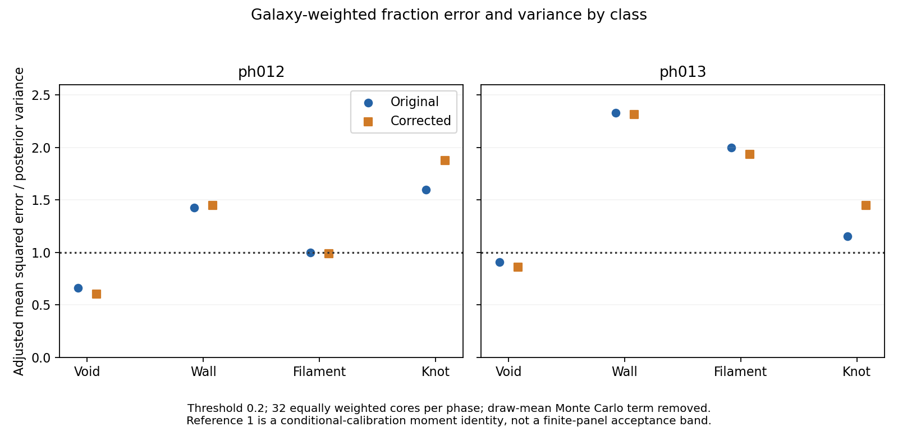
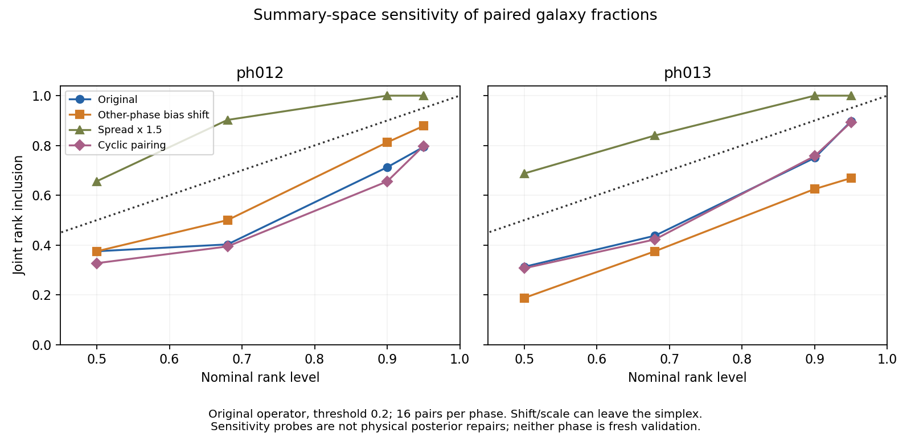

# Stage C diagnosis of class fraction uncertainty

The saved-draw tests reject a single global bias shift, a uniform spread
increase, and removal of cross-region pairing as sufficient explanations or
repairs. The most repeatable discrepancy is in **interior-region class
fractions**: draw-noise-adjusted mean squared error is 2.70/2.11 times predicted
variance in ph012/ph013, versus 0.75/0.96 at boundaries. This is a descriptive
conditional pattern, not proof of its cause or a qualification of boundaries.

No training intervention is selected. The field remains informative, but these
results do not establish which change to its learned conditional distribution
would repair calibration. Retain the original model and operator candidate as
comparators. Do not use the sensitivity transforms as physical posterior draws.

## Scope and frozen comparisons

The user approves proceeding with mechanism discrimination and compute. This
execution uses one CPU allocation for saved-draw analysis only: all 32 registered
pairs, 64 cores, 32 draws, and the same ph012/ph013 development phases as
[Stage B](e2e_stage_b_execution_20261006.md). No new density draws, GPU use,
model training, additional phase access, P12-A change or property estimator is
included. The B3 property gap remains unchanged.

The [configuration](../configs/e2e_stage_c_mechanism_20261006.json) freezes the
moment decomposition, opposite-phase bias transfer, spread multipliers 1/1.5/2,
all 32 cyclic right-core pairing offsets, and Stage A factor comparison before
new diagnostic scores. Galaxy-weighted fractions at threshold 0.2 with the
original operator are primary. Corrected-operator, volume-weighted, threshold-zero,
cap, shell and support results remain in the complete artifact. No best scale
or best subgroup is fitted or selected.

The source-quality checks preserve exactly the Stage B IDs, counts, cell
assignments and physical R7 labels. This remains field-at-observed-coordinate
evidence, not true-host environments or a real-data VAC validation. Regional
summaries weight each core equally; they do not use the pooled galaxy weighting
of the B1 per-galaxy Brier score.

## Error accounting

For a region or paired vector, let `e = mean(draws) - truth`, and let `S` be
the unbiased within-ensemble covariance of its M=32 draws. Across the declared
panel compute

```
Q = mean(e e^T) - mean(S)/M
b = mean(e)
Q = b b^T + [mean((e-b)(e-b)^T) - mean(S)/M].
```

The decomposition is exact arithmetic. Under conditionally independent draws
from a calibrated posterior, averaging over the appropriate conditioning
population gives `E[Q] = E[S]`. The reported diagonal or trace ratio compares
these two moments; 1 is a population identity, not an acceptance band for this
small dependent panel. Ratios are ratios of averaged moments, not averages of
per-region ratios. Negative Monte Carlo-adjusted moments are retained.

A mean offset and an inadequately dispersed posterior can both cause
undercoverage. Removing a panel-wide offset does not remove heterogeneous
conditional bias. Consequently, a remaining excess error-to-variance ratio
does **not** by itself prove that enlarging spread is the right repair.
Generalized covariance spectra are retained as descriptive geometry, with the
fixed numerical floor recorded. Six-dimensional spectra from only 16 dependent
pairs are not a population covariance test. No iid confidence bands are used.

## Global shifts and spread do not explain the panel consistently

The common four-class mean offset accounts for only 6.58/6.46% of the original
panel's total mean squared error. Removing it algebraically leaves aggregate
adjusted-error/variance ratios of 1.018/1.632. These fractions describe the
panel-wide offset, not the total amount of conditional model bias.

Classwise adjusted-error/variance ratios are markedly nonuniform:

| Operator and phase | Void | Wall | Filament | Knot |
| --- | ---: | ---: | ---: | ---: |
| Original ph012 | 0.661 | 1.429 | 1.001 | 1.597 |
| Original ph013 | 0.906 | 2.330 | 2.001 | 1.154 |
| Corrected ph012 | 0.605 | 1.449 | 0.987 | 1.877 |
| Corrected ph013 | 0.859 | 2.316 | 1.936 | 1.449 |



The bias-transfer probe subtracts the four-class mean error estimated from
the *other* development phase, separately by operator and weighting. It uses
development truth and is neither train-only calibration nor fresh validation.
The spread probes scale deviations around each region's posterior mean by
the fixed factors. Neither probe clips or projects fractions onto the simplex;
the resulting invalid fraction vectors are counted explicitly.

For the original operator, paired joint rank coverage at nominal 90% and the
joint energy score give:

| Probe | Coverage ph012/ph013 | Energy ph012/ph013 | Invalid vectors ph012/ph013 |
| --- | --- | --- | --- |
| Unchanged | 71.25 / 75.00% | 0.11871 / 0.10514 | 0 / 0% |
| Other-phase bias subtraction | 81.25 / 62.50% | 0.10938 / 0.11001 | 5.37 / 4.69% |
| Spread times 1.5 | 100 / 100% | 0.12237 / 0.10237 | 12.11 / 11.13% |
| Spread times 2 | 100 / 100% | 0.13395 / 0.10677 | 18.36 / 17.38% |

Bias transfer helps ph012 but harms ph013. Uniform widening overshoots the
coverage curve, not just its 90% point: at nominal 50%, the 1.5 multiplier
already gives 65.625/68.75%. It worsens the ph012 energy score by 3.08%, while
improving ph013 by 2.64%. The corrected operator repeats these qualitative
failures. A post-hoc choice of an intermediate multiplier is not licensed by
this diagnostic, and none of these transforms defines a physical field repair.

## Dependence between regions is not the whole problem

Each cyclic pairing keeps the complete four-class draw vector within each
core intact and shifts only the right-core draw index. Across all 32 offsets,
including identity, the average cross-core covariance is exactly zero. This
preserves core marginal distributions and the simplex, unlike independently
shuffling individual classes. The average score response is a sensitivity
probe, not an exchangeable calibration null or 32 independent new datasets.

Original paired joint 90% coverage becomes 65.55/75.74%, from 71.25/75%.
Corrected coverage becomes 65.25/71.64%, from 71.25/68.75%. There is no
phase-stable joint improvement. Original paired energy barely changes,
0.11871/0.10514 to 0.11863/0.10544. Removing cross-core dependence therefore
does not explain or repair the main failure. This does not clear within-core
spatial dependence, class dependence, or the shape of conditional distributions.



## Interior and boundary regions differ

These were predeclared support strata, with eight pairs and 16 cores in each
phase and stratum. The class-summed adjusted-error/variance ratios are:

| Stratum | Original ph012/ph013 | Corrected ph012/ph013 |
| --- | --- | --- |
| Boundary | 0.753 / 0.963 | 0.750 / 0.993 |
| Interior | 2.701 / 2.106 | 2.636 / 2.100 |

Even after algebraically removing each stratum's own common mean offset,
original interior ratios remain 2.320/2.018. This is not solely a highest-redshift
issue: original aggregate ratios in centroid shells 0 and 1 are 1.523/1.473
and 1.560/1.921 respectively. The small strata do not identify precise
population effects. Boundary aggregate moments near unity do not establish
boundary joint calibration, and no restricted-domain qualification follows.

## What the Stage A comparison does and does not identify

Using the same accounting on saved orthonormal traceless tensor components
averaged within cores gives:

| Factor and conditioning | Adjusted-error/variance ph012/ph013 |
| --- | --- |
| Sampled coarse component | 1.015 / 0.902 |
| Fine component given sampled coarse | 1.404 / 0.840 |
| Fine component given true coarse | 0.872 / 1.002 |

True-coarse conditioning moves the aggregate fine ratio closer to unity in
both phases, consistent with Stage A's sensitivity to conditioning/composition.
It does not prove that the fine model is solely at fault. In the interior
stratum specifically, sampled-coarse and sampled-conditioned-fine ratios are
0.904/1.046 and 1.040/0.748: a universal shortage of these mean-shear variances
does not explain the much larger class-fraction discrepancies.

These are **different summaries and operator targets**: Stage A factor
projections use matched local decomposition truth, while B2 uses full-cap class
labels against physical R7 truth. Regional class fractions depend nonlinearly
on cell-level eigenvalues and spatial dependence, not just the core-mean tensor.
The comparison prioritizes conditional spatial/class structure as an unresolved
mechanism; it does not causally attribute B2 errors to a particular factor.

## Intervention decision

Do not launch the matched training stage yet. A global offset does not transfer
consistently, uniform variance inflation is inappropriate across classes and
strata, and destroying cross-region pairing does not help consistently. The
operator correction is still a comparator, not a calibration solution.

The next hypothesis worth specifying is that the model gives the wrong
**condition-dependent within-region class/spatial uncertainty**, most visibly
in the interior stratum. Current evidence does not distinguish conditional
mean error from covariance/non-Gaussian shape error there, nor assign it to
coarse versus fine learning. No particular loss, augmentation or architecture
change is justified by these summaries alone. In particular, independently
perturbing coarse inputs against unchanged fine targets remains invalid by
default under the exact-mass decoder contract.

Before another fit, a candidate must specify a valid joint training/inference
law and a discriminating control that addresses that uncertainty, using
training-only construction. Retain interior fraction calibration as a
diagnostic priority, but freeze any revised primary objective before the
candidate experiment; do not retrospectively redefine the completed gate.
Otherwise stop model-search expansion and consolidate this failure map, as the
Stage C protocol permits. P12-A writing remains independent of this outcome.

## Verification and provenance

Nine focused tests cover moment identities, finite-draw correction, bias versus
spread, a synthetic dependence-only failure, negative adjusted moments, exact
identity/tie preservation, invalid affine fractions, cyclic pairing, variance
sum/difference identities and shape/degenerate guards. All pass.

The two-case pilot completed in 1.83 seconds; the full panel took 22.09 seconds
and 0.572 GiB peak host RSS. All 2,112 source-parity checks pass. Independent
review passes 17,596 arithmetic checks, including direct covariance matrices,
Cholesky-based generalized eigenvalues, all-pairs CRPS/energy, bias-source
separation, invalid-vector counts, all cyclic energy scores and unchanged B2
coverage parity. These are engineering checks, not independent cosmological
realizations. Both figures were visually inspected.

Allocation 59417200 used CPU node nid200014 and was released after verification.
No GPU was requested. Graphify queries work in cosmic_env; the required local
AST refresh again fails at filesystem `flock` with Errno 524. No locking
protection was bypassed and no global refresh is claimed.

Artifacts are under
`/pscratch/sd/d/dkololgi/abacus/e2e_field_v3/calibration_investigation_20261006_v1/c_mechanism/`.
`pilot/` and `full/` are separate create-once outputs. `full/PANEL.npz` contains
compact fraction and shear summaries, not copied density ensembles.

| Artifact | SHA-256 |
| --- | --- |
| Configuration | `ba6d44a81e68b1fd89c38e35606848093e86f7ef8b855948f04139dcf5b82047` |
| `full/COMPLETE.json` | `64c1158e260f22669af1e28754d0a2642cb037dc5bbf5391f6926a8cd16affcb` |
| `full/REVIEW.json` | `4e6d4a36bcbf5d92d1b6edb6ba5b3810c06081d47c5b36fb5b8d16de278e9201` |
| `full/PANEL.npz` | `26f5d813d3022f9c9432c95108564a51b411ea3f565372cc366c8053fd7289a3` |

Reproduction entrypoints in cosmic_env, on an authorized CPU allocation:
`workflows/sbi/e2e_stage_c_mechanism.py --pilot`, then the same entrypoint without
`--pilot`; review with `workflows/sbi/e2e_stage_c_mechanism_review.py --figures
docs/figures/e2e_stage_c_mechanism_20261006`. Existing output roots intentionally
fail rather than overwrite; any rerun needs a separately named root.
