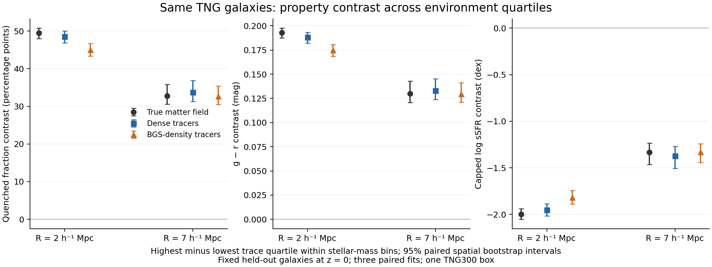

# Controlled TNG density and smoothing experiment

Completed 2026-10-15 (client date; host clock 2026-10-14). This is the requested
same-galaxy experiment, following [the density-causality report](tracer_density_causality_20261015.md).

**Finding:** random thinning by a factor of 7.56 produces a modest loss of the
mass-stratified property contrast when the estimator is retrained at that
density. Changing the true environment scale produces a larger change in the
primary trace-quartile contrast. This rejects a large, inevitable collapse of
that particular statistic from density alone in this TNG experiment. It does
not identify the cause of the old-GAT/current-P12 DESI difference.

## Primary result: fixed galaxies, environment quartiles

Environment is the trace of the matter-derived tidal tensor (sum of its three
eigenvalues), or the trace inferred from geometry. Within each 0.25-dex
stellar-mass bin, compare the highest and lowest quartiles; average those
contrasts with fixed weights from the common test population. Fractional
membership shares boundary ties and keeps quartile sizes equal. These are
density-environment ranks, not the four T-Web classes.

Quenched means instantaneous total SFR / total bound stellar mass < 1e-11/yr,
including zero SFR. All numbers below use the same 66,691 held-out galaxies,
9 <= log10(Mstar/Msun) < 11.5. Model entries average three paired seeds.

| Truth scale | True-field quenched contrast | Dense-trained estimate | Retrained at BGS density | Dense contrast lost |
|---|---:|---:|---:|---:|
| R=2 Mpc/h | 49.50 pp | 48.52 pp | 45.02 pp | 7.22% [5.49, 8.97] |
| R=7 Mpc/h | 32.73 pp | 33.75 pp | 32.64 pp | 3.28% [1.64, 5.42] |

Intervals are paired 95% spatial-bootstrap intervals, conditional on this
box, split and three fitted models. Absolute thinning losses are **3.50 pp
[2.65, 4.39] at R2** and **1.11 pp [.53, 1.88] at R7**. The true-field
R2-to-R7 difference is **16.77 pp [14.26, 18.73]**, or **33.88% [28.52, 37.68]**
of the R2 contrast. This is a different environmental question at a broader
scale, not inference error, and it does not invalidate the deliberate choice
of R7 for sparse BGS data.

| Property contrast, Q4 minus Q1 | R2 truth / dense / thin | R7 truth / dense / thin | Fraction lost under thinning, R2 / R7 |
|---|---|---|---|
| g-r [mag] | .1931 / .1880 / .1749 | .1299 / .1330 / .1295 | 7.01% / 2.68% |
| log10 sSFR [dex], floor 1e-14/yr | -1.999 / -1.954 / -1.817 | -1.332 / -1.373 / -1.329 | 7.00% / 3.22% |

The colour and capped-sSFR results support the same direction. Capping is
necessary to include zero-SFR galaxies in the logarithmic secondary outcome;
the uncapped binary quenched fraction is primary. These simulation properties
are not numerically interchangeable with observational SED-fitting estimates.

## Four-class check and frozen-model failure

Void/wall/filament/cluster mean zero/one/two/three eigenvalues above .2. On
common mass support across both radii and all retrained models, 62,580 queries
in 9 <= log10(Mstar/Msun) < 10.75 give:

| Scale | True cluster-minus-void quenched contrast | Dense estimate | Sparse retrained estimate | Fraction of dense contrast lost |
|---|---:|---:|---:|---:|
| R2 | 52.04 pp | 55.14 pp | 52.79 pp | 4.26% [1.91, 6.59] |
| R7 | 47.45 pp | 62.10 pp | 54.64 pp | 12.02% [7.30, 19.85] |

**The 34% smoothing result is specific to the primary quartile statistic.**
For these physical classes the true contrast falls by 4.59 pp [.39, 8.76].
The R7 regressor overstates the class contrast, so a strong predicted property
trend is not evidence of accurate class assignment. The model can select a
more extreme subset for a predicted class even when it uses no properties.
No class threshold or model was tuned to increase these contrasts.

Applying each dense-trained model and its dense feature scaler directly to
the thinned inputs, without retraining, loses **29.14% [23.67, 36.67]** of the
R2 quartile quenched contrast and **13.69% [10.76, 18.06]** at R7. All three
frozen R7 models classify every tested galaxy as void despite retaining a
trace rank correlation of .935-.955. Their R7 eigenvalue R2 scores are
negative. This is a clear distribution-shift failure; preserved ranking or
property association does not establish calibrated amplitudes or web classes.
It is a diagnostic of these regressors, not a replay of either production model.

For the retrained models, trace Spearman falls from .973-.975 to .897-.900
at R2, and .985-.986 to .960-.963 at R7. R7 shear correlation is only about
.50-.52. Thus good trace recovery is not full tidal-tensor recovery. The
isotropic input summaries have limited information about anisotropy.

A model-free, self-excluded aperture-count ranking gives quenched-contrast
losses of **9.47% [7.93, 11.54] at 2 Mpc/h** and **4.32% [2.60, 6.40] at
7 Mpc/h**. This supports the modest density-only effect without depending on
the neural fit, but counts are not an independent measurement of tidal shear.

## Construction and controls

- TNG300-1 snapshot 99, z=0, periodic box 205 Mpc/h, h=.6774. The 283,969
  tracers with bound stellar mass >=1e9 Msun exactly reproduce the archived
  graph selection and positions. Queries require SubhaloFlag and finite
  properties: 276,007 valid queries. The other 7,962 rows remain tracers to
  preserve the original tracer population.
- Each of three seeded random subsets contains exactly 37,545 tracers,
  retaining 13.2215%. Density changes from .03296168 to .00435803 h^3/Mpc^3.
  The latter matches the recorded median selection-density estimate in the
  DESI z=.20-.30 property wedge. It is not the full BGS n(z). Query galaxies
  remain fixed whether or not they are retained as tracers; this deliberately
  isolates information loss from changes to the property sample.
- Both truths use the same cached total-matter density, periodic Gaussian
  smoothing, Poisson solve and Cactus-compatible twice-centred finite
  differences. Interpolate the tensor trilinearly at cell-centred coordinates,
  then diagonalize. The R2 archived-label comparison separately uses its
  original nearest-voxel sampling. No galaxy thinning changes the truth.
- Inputs are log(1+count) at 1,2,4,7,10,14 Mpc/h and log distances to neighbours
  1,5,10,20,40, all periodic and self-excluded. No stellar mass, colour, SFR,
  IDs or absolute position enters the model. Training targets are ordered
  inverse-softplus eigenvalue increments, standardized on training rows.
- Identical two-layer width-64 ReLU regressors use 2,000 Adam steps, batch
  2,048, learning rate .001, paired initialization and minibatch seeds. Choose
  the checkpoint by validation increment-space MSE every 100 steps. All 12
  fits completed; best checkpoints occur between steps 200 and 1,700. The
  budget is fixed, not a proof of globally optimal attainable performance.
- Spatial label split: x/L [.05,.40) train, [.50,.60) validation,
  [.70,.95) test; 102,815 / 25,588 / 67,052 valid rows. The buffer was enlarged
  to 20.5 Mpc/h before feature construction/training. After the common mass
  cut, 66,691 test rows remain. Tracer observations come from the same periodic
  box, including unlabelled held-out regions. These are not independent phases
  or strictly disjoint input contexts: 40th-neighbour distances reach 23.72
  Mpc/h in sparse inputs, and a few hundred all-box queries exceed the buffer.
- Paired bootstrap uses 400 resamples of the 50 occupied 41-Mpc/h spatial
  blocks in the test slab, with fixed mass-bin weights and the same block
  weights for every condition. Intervals condition on the three seeds and
  do not cover independent-volume or full retraining uncertainty. Seeds vary
  thinning and initialization together; their individual contributions are
  not separately estimated.

## Verification and provenance

The original R2 eigenvalues replay at 8,192 positions with maximum error
1.18e-11 and 100% class agreement. An analytic plane-wave tensor check has
5.55e-17 error, and the periodic constant-field check passes. Independent
brute-force counts and neighbour distances pass for 12 query/condition cases.

The 256^3 versus 512^3 mesh comparison has trace Spearman .999704 at R2 and
.999996 at R7; class agreement is 97.67%/99.67%. Mean eigenvalue differences
are 3.6-4.1% / .41-.54% of fine-grid standard deviations. The true quenched
quartile contrasts on the coarse mesh are 49.13/32.67 pp versus 49.50/32.73
on the fine mesh. This is a useful mesh-sensitivity check, not particle-mass,
deposition-kernel or infinite-resolution convergence certification.

Two hundred property permutations within mass bins give mean quenched
contrasts .0016 pp at R2 and -.0214 pp at R7, with central permutation ranges
approximately +/-1 pp. The first single-shuffle diagnostic is retained: its
R7 residual was -.844 pp and its conditional spatial interval narrowly
excluded zero. That chance realization is not suppressed or treated as a
formal null-test failure; the repeated randomizations characterize the null.

All 122 final validation checks pass. Independent point and raw-row bootstrap calculations reproduce the primary
contrasts to <1.1e-14; physical-class point calculations and saved checkpoint
prediction replay are also checked. See `VALIDATION.json` for the final count.

Code: `workflows/gcn_paper/tng_density_control_20261015.py`; fixed configuration:
`configs/tng_density_control_20261015.json`. Stages are `catalogue`, `truth`,
`features`, `train`, `analyse`, `verify`, `render`. Use cosmic_env and one BLAS/
OpenMP thread. Scheduler access failed before any allocation was created;
execution used the user's previously authorized bounded one-thread fallback.
Scratch was read-only, so compact outputs are under
`/global/u2/d/dkololgi/fmsu_tokyo_20261010/tng_density_control_20261015`.
No 3-D grids were saved; source data were left untouched. Source hashes, extracted
catalogue-field hashes, checkpoints, predictions and row-level test evidence
are retained; the repository evidence directory holds the small final receipts.
The truth receipt binds the earlier configuration before the split-buffer
revision; truth fields are unaffected. The final configuration is copied into
the manifest bundle with the final script.

Property definitions follow the [official TNG data specification](https://www.tng-project.org/data/docs/specifications/).

## What this establishes and leaves open

This experiment identifies the effect of randomly removing tracer information
for a fixed TNG population, fixed density reference and fixed estimator family.
It establishes neither a causal effect of environment on quenching nor a
percentage attribution of the observed DESI discrepancy. It is one small
z=0 hydro volume, with real-space periodic inputs, a point regressor, and no
luminosity selection, RSD, lightcone evolution, fibres or survey mask.

The relevant next discrimination is **random versus luminosity-selected
tracers at matched number density**, followed by RSD and observation effects,
using the actual production estimator and verified truth mapping. Those may
change tracer bias and small-scale information even at the same density.
The present result supports treating smoothing, selection and adaptation as
separate mechanisms; it does not support calling the observed loss “just
tracer density,” nor does it disprove the need for R7 in the Abacus/BGS setup.
